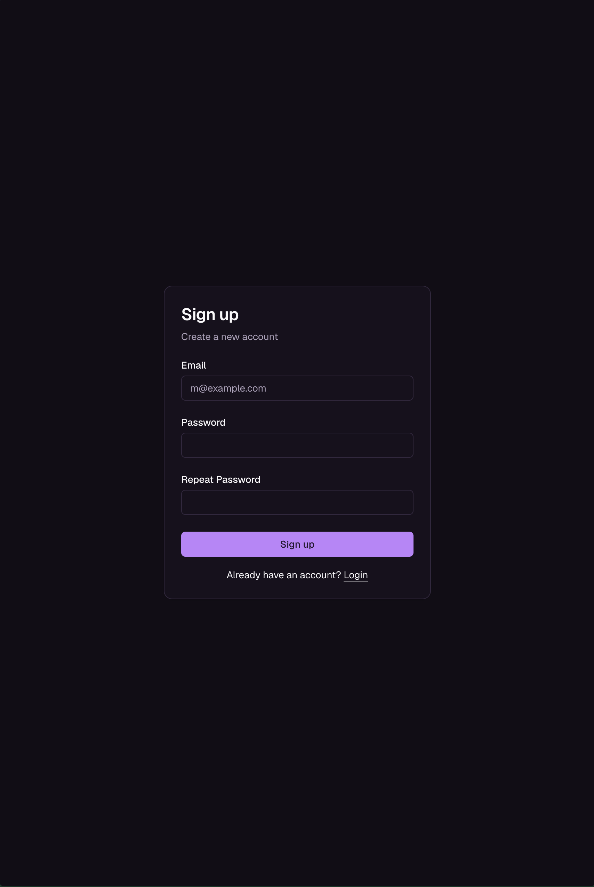
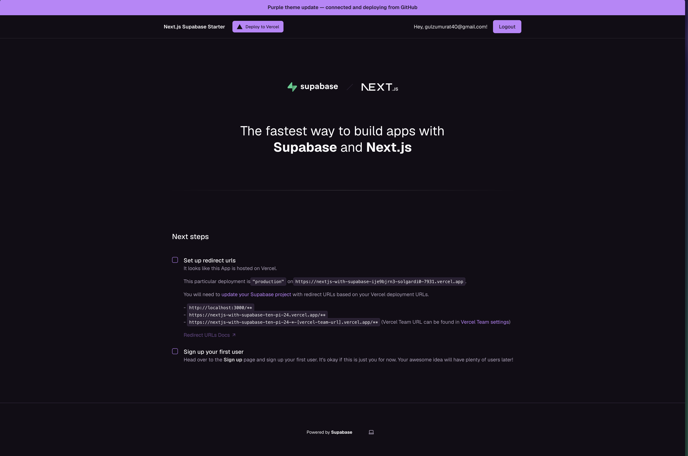
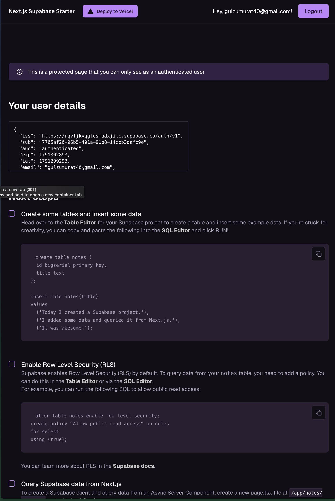
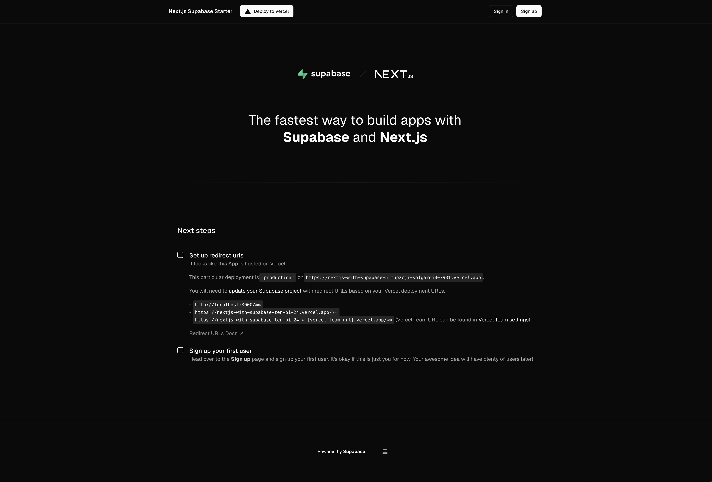
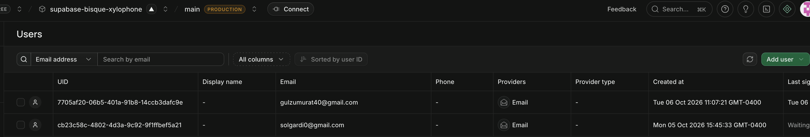
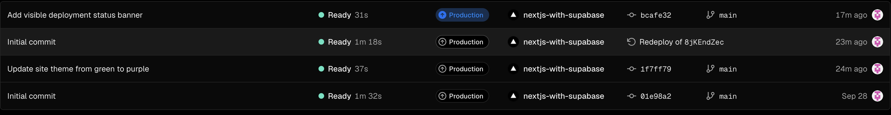

Where does your code live? on github
Where does your data live, and what is stored there right now? supabase, user's emails - galzumarat@gmail.com, solgardi0@gmail.com, gulzumurat40@gmail.com, lolherrera79@gmail.com
How does a change get from Claude Code to the live site? List the steps.claude changes the code on github, then github tells vercel to like redeploy the site and then the vercel updates the site
What will you need to add to turn this into your team's app? Use your product manager's feature list. I would need to add a group chat, notifications feature and other stuff

